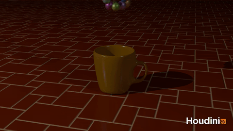
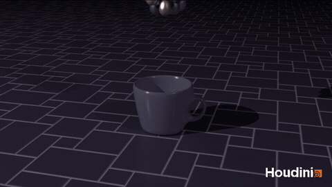
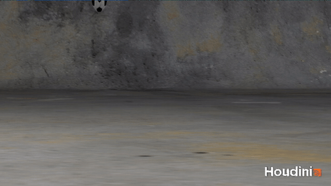
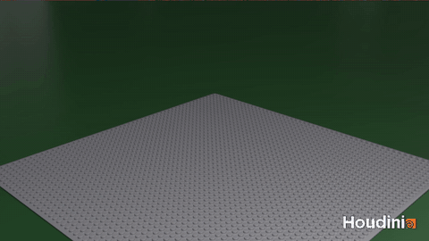
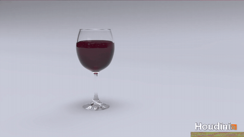
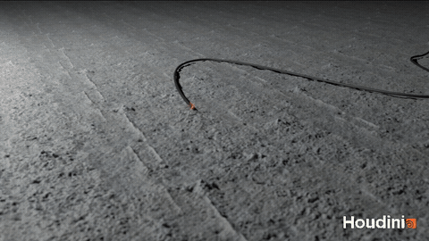

# Houdini Learning

My work through SideFX's Houdini Foundations lessons. Each folder has the `.hipnc` scene file and the final render.

## Overview: Gumballs & Eggs

Model a coffee cup and use dynamics to simulate a collection of gumballs falling into it. Then modify the simulation with different gumball shape, cup size, and scene colors.

Lesson: [H22 Foundations: Welcome](https://media.sidefx.com/files/tutorials/h22-foundations-welcome/h22_foundations_welcome_v2.pdf)

## Soccer Ball

Model a soccer ball, texture it, rig it, and animate it bouncing and rolling across a concrete floor. Then light and render the shot.

Lesson: [H22 Foundations: Model, Render, Animate](https://media.sidefx.com/files/tutorials/h22-foundations-model-render-animate/h22_foundations_soccerball_v1.pdf) $\cdot$ [Project Files](https://media.sidefx.com/files/tutorials/h22-foundations-model-render-animate/soccerball_lesson_start.zip)

## Brickify

A node network that turns any model into toy bricks, packaged as a reusable digital asset (`hda/brickify.hdanc`) and demonstrated on a textured test model.

Lesson: [H20.5 Foundations: Nodes, Networks & Assets](https://media.sidefx.com/files/tutorials/foundations-205-nodes-networks-assets/foundations20_5_brickify_tutorial.pdf)

## Smashing Wineglass

A bullet shatters a wine glass: RBD fracturing for the glass and a FLIP fluid sim for the wine.

Lesson: [H21 Foundations: Smashing Wineglass](https://media.sidefx.com/files/tutorials/h21-foundations-smashing-wineglass/h21_foundations_smashing_wineglass.pdf) $\cdot$ [Project Files](https://media.sidefx.com/files/tutorials/h21-foundations-smashing-wineglass/fluids_lesson_start.zip)

## Destruction FX

A fuse burns down and a bomb explodes. Uses a spark particle sim, RBD destruction, a Pyro fireball, and a soot trail, all rendered in Solaris.

Lesson: [H19.5 Foundations: Destruction FX](https://media.sidefx.com/files/tutorials/foundations-destruction-fx/hfoundations19_5_05_destructionfx.pdf)
